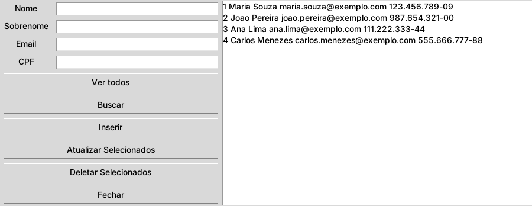
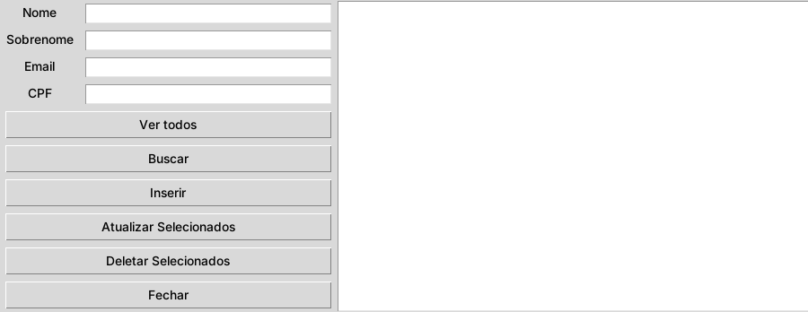
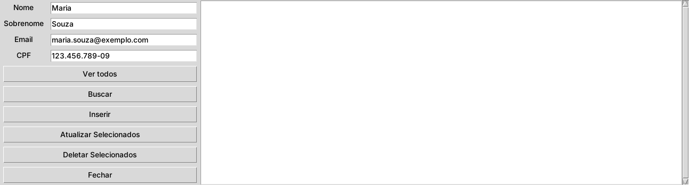
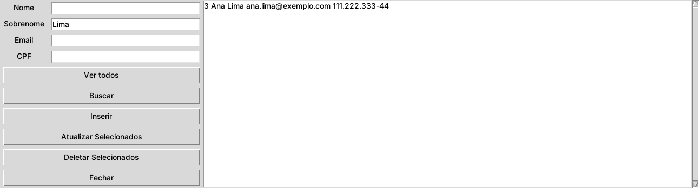
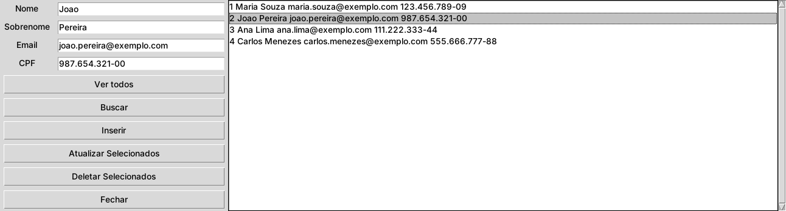
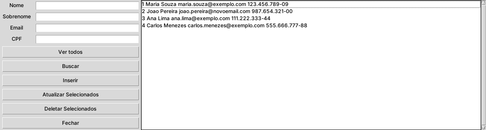
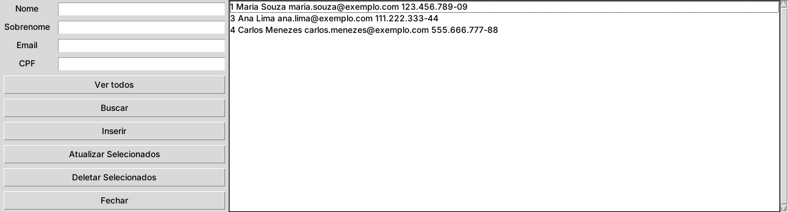
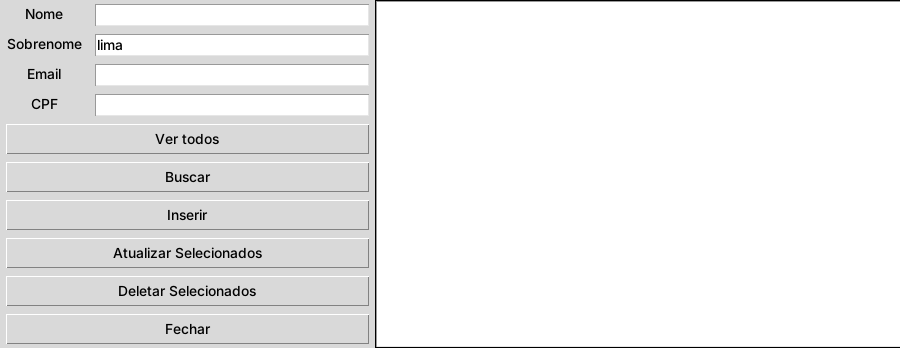
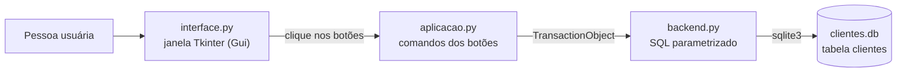

<h1 align="center">PYSQL Interface</h1>

<p align="center">
  <b>Cadastro de clientes com interface gráfica, do formulário ao banco de dados.</b><br>
  Um aplicativo desktop em Python que faz o CRUD completo (cadastrar, listar, buscar, editar e excluir) com Tkinter na tela e SQLite guardando tudo em um único arquivo local. Roda pelo código-fonte ou pelo executável do Windows, sem instalar nada.
</p>

<p align="center">
  
  
  
  
  
  
</p>

<p align="center">
  <a href="#como-rodar">Como rodar</a> ·
  <a href="#telas-e-como-usar">Telas</a> ·
  <a href="#arquitetura">Arquitetura</a> ·
  <a href="#banco-de-dados">Banco de dados</a> ·
  <a href="#gerando-o-executável">Executável</a> ·
  <a href="#licença">Licença</a>
</p>

<p align="center">
  
</p>

---

## Sumário

- [Visão geral](#visão-geral)
- [Telas](#telas)
- [Arquitetura](#arquitetura)
- [Como rodar](#como-rodar)
- [Banco de dados](#banco-de-dados)
- [Estrutura do projeto](#estrutura-do-projeto)
- [Gerando o executável](#gerando-o-executável)
- [Limitações e próximos passos](#limitações-e-próximos-passos)
- [Objetivo educacional](#objetivo-educacional)
- [Autor](#autor)
- [Licença](#licença)

## Visão geral

O PYSQL Interface resolve o básico de qualquer cadastro: guardar pessoas, achá-las de volta e mexer nos dados sem abrir um banco de dados na mão. É um projeto pequeno e de propósito, pensado para estudar como uma interface gráfica conversa com um banco de dados.

| | O que o PYSQL faz |
|---|---|
| **Cadastrar** | Quatro campos (nome, sobrenome, e-mail e CPF) e um clique em **Inserir**. O cliente ganha um `id` automático. |
| **Listar** | **Ver todos** mostra todos os clientes em uma lista com barra de rolagem. A lista também atualiza sozinha depois de inserir, atualizar ou excluir. |
| **Buscar** | Procura por nome, sobrenome, e-mail ou CPF. Basta preencher um ou mais campos e clicar em **Buscar**. |
| **Editar** | Clicar em um cliente da lista joga os dados dele nos campos. Altere o que precisar e use **Atualizar Selecionados**. |
| **Excluir** | **Deletar Selecionados** remove o cliente escolhido na lista. |
| **Persistência** | Tudo é gravado na hora em um arquivo SQLite (`clientes.db`). O banco é criado sozinho na primeira execução. |
| **Sem instalação** | O executável da pasta `dist/` roda no Windows sem Python instalado. |

## Telas

A janela se chama **PYSQL versão 1.0**: campos e botões à esquerda, lista de clientes à direita. As telas usam dados fictícios.

| | |
|---|---|
|  |  |
| **Início**: banco recém-criado, campos vazios e lista sem clientes. | **Cadastrar**: preencha nome, sobrenome, e-mail e CPF e clique em **Inserir**. |
|  |  |
| **Listar**: a lista mostra `id nome sobrenome email cpf` e atualiza sozinha a cada alteração. **Ver todos** recarrega quando quiser. | **Buscar**: preencha um ou mais campos e clique em **Buscar**. Aqui, o sobrenome `Lima` trouxe um cliente. |
|  |  |
| **Selecionar**: clicar em um cliente da lista carrega os dados dele nos campos. | **Atualizar**: com o e-mail alterado, **Atualizar Selecionados** regrava o cliente e recarrega a lista. |
|  |  |
| **Excluir**: **Deletar Selecionados** remove o cliente escolhido do banco e da lista. | **Sem resultado**: a busca é exata e diferencia maiúsculas, então `lima` não encontra `Lima`. |

O botão **Fechar** encerra o aplicativo.

## Arquitetura

O código é dividido em três arquivos, cada um com uma responsabilidade.



| Arquivo | Papel |
|---|---|
| [`interface.py`](interface.py) | Classe `Gui`: cria a janela, os campos, a lista com barra de rolagem e os botões, e define o layout em grade |
| [`aplicacao.py`](aplicacao.py) | Ponto de entrada. Liga cada botão ao seu comando (`view_command`, `search_command`, `insert_command`, `update_command`, `del_command`) e trata a seleção na lista |
| [`backend.py`](backend.py) | Classe `TransactionObject`: conecta ao SQLite, cria a tabela e faz `insert`, `view`, `search`, `update` e `delete` |

Cada operação abre a conexão, executa, grava (`commit`) quando altera dados e fecha. Os valores entram na consulta como parâmetros (`?`), nunca concatenados no texto SQL, o que evita SQL injection.

## Como rodar

### Opção 1: executável (recomendado para testar)

Se você não tem Python instalado:

1. Baixe o arquivo [`dist/aplicacao.exe`](dist/aplicacao.exe).
2. Dê dois cliques nele.

Nenhuma instalação é necessária. O banco `clientes.db` é criado na pasta de onde você abre o programa.

> **Aviso:** alguns antivírus desconfiam de executáveis gerados pelo PyInstaller. O arquivo apenas empacota o código Python deste repositório, que você pode ler e rodar direto da Opção 2.

### Opção 2: pelo código-fonte

**Pré-requisito:** Python 3.8 ou superior com Tkinter (já vem no instalador do Python para Windows e macOS).

```bash
git clone https://github.com/Nadruz/PYSQL-interface.git
cd PYSQL-interface
python aplicacao.py
```

> No Linux, o Tkinter costuma ser um pacote à parte. No Ubuntu e no Debian: `sudo apt install python3-tk`.

O projeto não usa nenhuma biblioteca externa: `tkinter` e `sqlite3` fazem parte da biblioteca padrão do Python.

## Banco de dados

O arquivo `clientes.db` é criado automaticamente, na pasta de onde o programa é executado, com uma única tabela:

```sql
CREATE TABLE IF NOT EXISTS clientes (
    id        INTEGER PRIMARY KEY,
    nome      TEXT,
    sobrenome TEXT,
    email     TEXT,
    cpf       TEXT
);
```

| Coluna | Tipo | Descrição |
|---|---|---|
| `id` | INTEGER, chave primária | Gerado automaticamente a cada cadastro |
| `nome` | TEXT | Primeiro nome |
| `sobrenome` | TEXT | Sobrenome |
| `email` | TEXT | E-mail |
| `cpf` | TEXT | CPF, guardado como texto, do jeito que foi digitado |

Para recomeçar do zero, feche o programa e apague o `clientes.db`. Para olhar os dados por fora, abra o arquivo em qualquer visualizador de SQLite, como o [DB Browser for SQLite](https://sqlitebrowser.org/).

## Estrutura do projeto

```text
PYSQL-interface/
  aplicacao.py      ponto de entrada: liga os botões aos comandos
  interface.py      janela e widgets (Tkinter)
  backend.py        acesso ao SQLite (CRUD)
  dist/
    aplicacao.exe   executável para Windows, gerado com PyInstaller
    clientes.db     banco vazio de exemplo
  build/            arquivos intermediários do PyInstaller
  docs/images/      capturas de tela usadas neste README
  README.md
```

## Gerando o executável

O `aplicacao.exe` foi gerado com [PyInstaller](https://pyinstaller.org/). Para gerar o seu, no Windows:

```bash
pip install pyinstaller
pyinstaller --onefile --windowed aplicacao.py
```

O executável novo aparece em `dist/`. A opção `--windowed` esconde a janela preta do terminal.

## Limitações e próximos passos

O projeto é didático, e algumas escolhas simples ficam como oportunidade de melhoria:

- A busca compara o valor **exato** e diferencia maiúsculas de minúsculas. Buscar `lima` não encontra `Lima`, e buscar parte de um nome não encontra nada.
- **Atualizar** e **Deletar** precisam de um cliente selecionado na lista. Sem seleção, o botão não tem o que fazer.
- Os campos não são validados. CPF e e-mail aceitam qualquer texto, e o mesmo CPF pode ser cadastrado mais de uma vez.
- Não há confirmação antes de excluir.

Ideias para evoluir:

- [ ] Busca parcial e sem diferenciar maiúsculas (`LIKE`)
- [ ] Validação de CPF e de e-mail
- [ ] Impedir CPF duplicado (`UNIQUE`)
- [ ] Mensagem ao tentar atualizar ou excluir sem selecionar um cliente
- [ ] Janela de confirmação antes de excluir
- [ ] Tabela com colunas (`ttk.Treeview`) no lugar da lista de texto

## Objetivo educacional

Projeto desenvolvido para fins de aprendizado, abordando:

- CRUD com SQLite e SQL parametrizado
- Interfaces gráficas com Tkinter (grade, eventos e `Listbox`)
- Separação do código em camadas (interface, comandos e banco)
- Estruturação de projetos Python
- Geração de executáveis com PyInstaller

## Autor

Desenvolvido por **Nadruz**.
GitHub: [github.com/Nadruz](https://github.com/Nadruz)

## Licença

Projeto de uso **educacional**.
